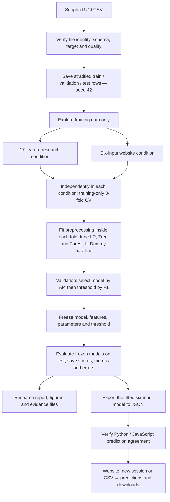
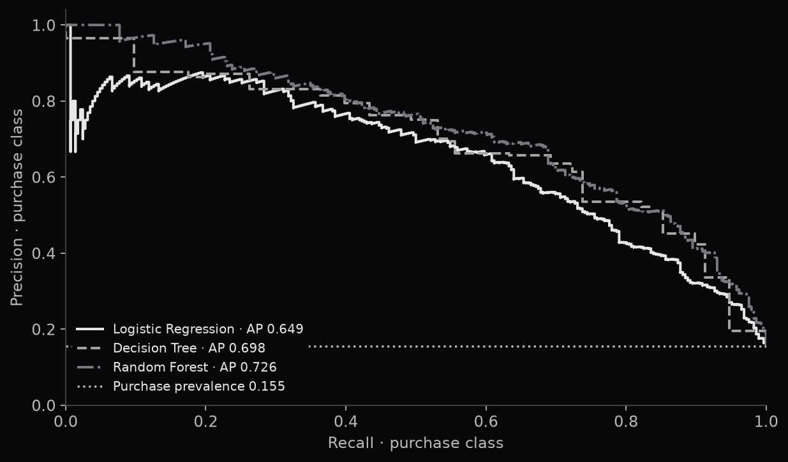

# ShopperSense — Online Shopping Purchase Intention Prediction

ShopperSense uses machine learning to study browsing-session behaviour and predict whether a session will end in a purchase. It combines a reproducible model comparison with an interactive website for scoring new sessions individually or from a CSV. Predictions describe patterns learned from historical data; they do not confirm a visitor's intentions or guarantee a sale.

**Live Website:** [Open the prediction workspace](https://vivek-314.github.io/ShopperSense-study/)

**Research Report:** [Read the investigation and results](https://vivek-314.github.io/ShopperSense-study/#research)

**Model Code:** [Explore the executed, cell-by-cell training notebook](notebooks/03_six_input_models_step_by_step.ipynb)

## Motivation — Why ShopperSense?

An online store can receive many visits without every visitor making a purchase. Some people browse products extensively, others look for information, and others leave quickly. These recorded activities may contain useful signals about which sessions are associated with purchasing.

We developed ShopperSense to investigate those signals using a modest, understandable set of machine-learning methods. The aim is to compare the evidence carefully and make the resulting model usable by someone who does not work with ML code. For a business user, the website offers a way to explore session prioritisation; this project has not demonstrated increased sales, marketing ROI or the effect of contacting a visitor.

## Problem Statement and Project Objectives

The question is: **How well can recorded browsing-session characteristics identify sessions that end in a purchase, compared with always predicting no purchase?**

This is a **binary classification** problem: each session belongs to one of two outcome classes.

| Element | Meaning in this project |
| --- | --- |
| Unit of analysis | One recorded browsing session, not a person's lifetime customer profile |
| Inputs | Observed session characteristics such as page counts, time spent and visitor type |
| Target | `Revenue`: `TRUE` / `1` means purchase; `FALSE` / `0` means no purchase |
| Model output | A purchase score and a purchase/no-purchase label using a fixed decision cutoff |

The objectives are to establish a majority-class baseline, compare three standard classifiers, inspect their mistakes, measure dependence on selected features, and provide a practical interface for new inputs. We also examine the tradeoff between detecting buyers and generating false purchase alarms.

The data consists of historical session summaries. Performance partway through a live visit is a separate question that this dataset and evaluation have not validated.

## What Does ShopperSense Do?

### A. Machine-learning research

The research workflow audits the supplied dataset, explores training data, fits models through consistent pipelines, and compares their validation and test performance. It also studies errors, tree depth, removal of `PageValues`, and identical inputs crossing partition boundaries. The [research report](https://vivek-314.github.io/ShopperSense-study/#research) explains these results without requiring readers to run a notebook.

### B. Interactive prediction website

The [website](https://vivek-314.github.io/ShopperSense-study/) accepts six clearly labelled inputs or a CSV containing multiple new sessions. It returns real model predictions, input influences, review priorities and downloadable results. Inference runs in the browser using an exported fitted model; it does not look up a customer in a fixed list of saved predictions.

These components use **different fitted models**. The research benchmark uses all 17 predictors, including analytics variables that need a prediction-time availability audit. The website uses a separately trained six-input model to keep data entry practical. The stronger research results must not be attributed to the website predictor.

## Dataset Overview

We use the [UCI Online Shoppers Purchasing Intention Dataset, dataset 468](https://archive.ics.uci.edu/dataset/468/online+shoppers+purchasing+intention+dataset), attributed to C. Sakar and Yomi Kastro (2018), [DOI: 10.24432/C5F88Q](https://doi.org/10.24432/C5F88Q). It is licensed under [CC BY 4.0](https://creativecommons.org/licenses/by/4.0/).

| Property | Verified supplied file |
| --- | --- |
| Sessions | 12,330 |
| Predictors | 17 |
| Target column | `Revenue` |
| Purchase sessions | 1,908 — approximately 15.5% |
| Non-purchase sessions | 10,422 — approximately 84.5% |
| Missing cells / infinite numeric values / negative numeric values | 0 / 0 / 0 |
| Excess complete duplicate rows | 125, preserved |

The observed dimensions and class counts match the UCI description. The file was supplied locally; its original download date is unknown. The [data documentation](data/README.md), [manifest](results/data_manifest.json) and [quality report](results/quality.json) record its exact identity and inspection findings. We did not compare its bytes against a newly downloaded UCI archive.

### What the features represent

| Dataset fields | Plain-language meaning | Used by the website? |
| --- | --- | --- |
| `ProductRelated`, `ProductRelated_Duration` | Product-related page count and total time spent on those pages | Yes |
| `Informational`, `Informational_Duration` | Informational page count and total time spent on those pages | Yes |
| `Administrative`, `Administrative_Duration` | Administrative-category page count and time | No; removed from the practical predictor |
| `BounceRates`, `ExitRates` | Page-level analytics measures of bouncing and exits | No |
| `PageValues` | An analytics measure of value associated with pages visited before a transaction | No; feature availability is a research concern |
| `SpecialDay` | Proximity to a special day, on a 0–1 scale | No |
| `Month`, `OperatingSystems`, `Browser`, `Region`, `TrafficType` | Calendar, device, region and traffic categories; numeric codes are category labels | No |
| `VisitorType` | New visitor, returning visitor or other | Yes |
| `Weekend` | Whether the visit occurred on a weekend | Yes |

Page-category examples such as information or account pages are guidance, not a mapping to a particular store's URLs. Real exports need consistent category definitions. Product-page counts do not necessarily count different products.

The class imbalance matters: a model that always predicts no purchase can appear accurate while missing every buyer. That is why purchase-focused metrics accompany accuracy throughout the project.

## Project Workflow



Structural inspection covers the whole source file; exploratory comparisons use training rows. Data splitting happens before any learned preprocessing. Each condition then runs its own training-only search and validation decision, with no refit on validation after selection.

The research workflow also includes prespecified no-`PageValues` runs and a separate duplicate-group sensitivity. The six-input model reuses the saved row IDs for comparison with earlier conditions; it is not an independently collected external test.

## Data Preprocessing

We preserve the raw CSV and assign stable, zero-based `source_row_id` values from its original order. Repeated rows and large values are retained rather than automatically removed. The audit found no detected invalid category/range values or noninteger page counts. Skewed activity distributions are inspected with training summaries and log-scaled plots; those plotting choices do not automatically transform model inputs.

| Processing choice | Implementation and reason |
| --- | --- |
| Binary fields | Explicit `Revenue` and `Weekend` conversion to 0/1 |
| Numeric missingness | Training median if needed; no missing values were observed in the supplied file |
| Categorical missingness | A fixed missing-category token if needed |
| Categorical encoding | `OneHotEncoder(handle_unknown='ignore')`; category codes do not imply ordered distances |
| Numeric scale | `StandardScaler` for Logistic Regression; original scale for trees |
| Excluded model inputs | Target and source row ID in every condition; the website also excludes all fields outside its six-input contract |
| Imbalance / outliers | Stratification and purchase-focused evaluation; no SMOTE, class weighting, clipping or automatic outlier removal |

`Pipeline` and `ColumnTransformer` ensure medians, category vocabularies and scaling statistics are fitted inside each training fold. Validation and test distributions do not enter those fitted transformations.

The primary split holds out 15% test, then uses `15/85` of the remaining rows as validation. Both calls stratify `Revenue` with `random_state=42`.

| Partition | Sessions | Purchases | Purpose |
| --- | ---: | ---: | --- |
| Training | 8,630 | 1,336 | Fit preprocessing, tune parameters and fit estimators |
| Validation | 1,850 | 286 | Select model and decision threshold |
| Test | 1,850 | 286 | Evaluate the frozen decisions |

Exact IDs, class counts and source checksum are saved in [splits.json](results/splits.json). See [data.py](src/data.py), [research preprocessing](src/preprocessing.py) and [practical-model preprocessing](src/predictor/train.py) for implementation.

## Machine-Learning Models

| Model | How it works and why it is included | Main limitation |
| --- | --- | --- |
| Dummy Classifier | Always predicts the training majority class; establishes the minimum useful reference | Ignores browsing activity and detects no buyers at the default cutoff |
| Logistic Regression | Fits a regularized linear relationship in log odds; offers a simple comparison | Limited nonlinear interactions without engineered terms |
| Decision Tree | Learns feature-threshold rules; captures nonlinear relationships and illustrates overfitting | Deeper trees can fit training details that do not generalize |
| Random Forest | Averages 150 randomized trees to reduce single-tree variance | Harder to interpret than one tree or a linear model |

The same bounded search design is used in the research and practical conditions:

| Model | Training-only grid |
| --- | --- |
| Dummy | No search; `strategy='most_frequent'` |
| Logistic Regression | `C=[0.1, 1, 10]`; `max_iter=2000` |
| Decision Tree | `max_depth=[3, 5, 8]`, `min_samples_leaf=[5, 20]` |
| Random Forest | `max_depth=[8, None]`, `min_samples_leaf=[2, 10]`; 150 trees |

`GridSearchCV` maximizes **average precision (AP)** using three shuffled stratified training folds and seed 42, then refits the best candidate on the full training partition. Every candidate and fold score is saved. Unresolved convergence warnings stop a training run. The research searches contain 20 candidates including the no-`PageValues` variants; the current practical comparison contains 13. Dummy is not tuned.

**Decision protocol:** select the highest validation AP among learned models; if a model is within 0.005 of the highest, prefer the simpler model in the order Logistic Regression, Decision Tree, Random Forest. This tolerance is a practical rule, not a significance test. For the selected model, maximize validation purchase F1 on `0.05, 0.06, …, 0.95`, breaking ties toward the larger cutoff. Save the decision before test evaluation, retain training-only fits, and never revise the choice from test rankings.

The [20-cell training notebook](notebooks/03_six_input_models_step_by_step.ipynb) contains actual estimator, search and `.fit(...)` code for each of the four models. Code cells 8–11 fit the models; later cells reproduce selection, evaluation and the deployed export.

## Feature Selection and the Practical Prediction Model

The full-feature benchmark investigates how informative the recorded dataset is. The website instead asks for a smaller set of fields that users can map from session activity, without requiring `PageValues`, bounce/exit analytics or technical category codes.

| Website input | Dataset field | What the user supplies |
| --- | --- | --- |
| `product_pages` | `ProductRelated` | Product-related page count |
| `product_seconds` | `ProductRelated_Duration` | Total product-page time in seconds |
| `information_pages` | `Informational` | Informational page count |
| `information_seconds` | `Informational_Duration` | Total informational-page time in seconds |
| `visitor_type` | `VisitorType` | New, returning or other visitor |
| `weekend` | `Weekend` | Yes/no weekend flag |

`session_id` is an optional reference and is never a predictor. All six browsing inputs are explicit; the browser rejects missing values instead of inventing unshown defaults. Enter zero only for genuinely absent activity, not unknown measurements.

Administrative/account page counts and durations were removed from the practical model to simplify the requested interface. They remain in the original data and research benchmark. Removal was measured, not justified by an unsupported claim of irrelevance:

| Random Forest condition | Validation AP | Test AP |
| --- | ---: | ---: |
| Earlier eight-input predictor | 0.316011 | 0.299416 |
| Current six-input predictor | 0.279134 | 0.293266 |

The [same-row comparison](results/predictor/feature_removal_comparison.csv) includes all three learned models. Earlier results are preserved in [predictor_previous_eight_inputs](results/predictor_previous_eight_inputs/). Each condition used the declared training search, so differences include any resulting parameter-selection change. These are descriptive comparisons, not causal or significance claims.

Both current selected models are Random Forests, but their fitted parameters and thresholds differ:

| Condition | Features | Selected forest parameters | Validation-selected cutoff |
| --- | ---: | --- | ---: |
| Research benchmark | 17 | 150 trees; unbounded depth; minimum leaf size 2 | 0.24 |
| Live website | 6 | 150 trees; maximum depth 8; minimum leaf size 10 | 0.12 |

Removing `PageValues` or simplifying the form does not prove that the remaining summaries were available early enough for a live intervention.

## Model Evaluation and Results

Purchase is the positive class in every table. Test results below use **1,850 sessions: 286 purchases and 1,564 non-purchases**. Display rounding is separate from unrounded saved scores and metric calculations.

| Metric | What it tells us |
| --- | --- |
| Accuracy | Fraction of all sessions classified correctly; can conceal missed buyers when non-purchases dominate |
| Precision | Of sessions predicted to purchase, the fraction that actually purchased: `TP / (TP + FP)` |
| Recall | Of actual purchase sessions, the fraction detected: `TP / (TP + FN)` |
| F1-score | Harmonic mean of precision and recall; used for the illustrative cutoff rule |
| Average precision (AP) | Purchase ranking quality across thresholds, summarized over recall increments; the primary model-selection metric, not trapezoidal PR-AUC |
| ROC-AUC | Complementary ranking discrimination between purchase and non-purchase sessions |
| Confusion matrix | Counts of true negatives (TN), false positives (FP), false negatives (FN) and true positives (TP) |

Precision is mathematically undefined when no positive predictions are made; the implementation uses `zero_division=0` and displays zero. Recall uses the same zero-division convention. Single-class ROC-AUC would be undefined. The class supports are included in saved outputs.

### Full-feature research benchmark

Validation selected Random Forest with AP **0.725437**. The test ranking did not change that selection. All models are compared at 0.50, with an additional row for the selected model's frozen 0.24 cutoff.

| Model | Cutoff | Accuracy | Precision | Recall | F1 | AP | ROC-AUC |
| --- | ---: | ---: | ---: | ---: | ---: | ---: | ---: |
| Dummy | 0.50 | 0.845 | 0* | 0.000 | 0.000 | 0.155 | 0.500 |
| Logistic Regression | 0.50 | 0.886 | 0.784 | 0.367 | 0.500 | 0.649 | 0.890 |
| Decision Tree | 0.50 | 0.900 | 0.749 | 0.531 | 0.622 | 0.698 | 0.919 |
| Random Forest | 0.50 | 0.897 | 0.762 | 0.483 | 0.591 | 0.726 | 0.919 |
| **Selected Random Forest** | **0.24** | **0.874** | **0.567** | **0.780** | **0.657** | **0.726** | **0.919** |

\*No predicted buyers; precision is displayed as zero by convention.

The majority baseline achieves 84.5% accuracy but misses all 286 buyers. At its selected cutoff, the research forest detects **223/286 buyers**, misses **63**, and falsely flags **170/1,564 non-buyers**. The Decision Tree has higher accuracy and F1 than the forest at 0.50; the forest was selected for validation AP, not because it won every metric.



*Generated from the research test predictions. This figure describes the 17-feature benchmark, not the live website model.*

Sources: [validation metrics](results/validation_metrics.csv), [test metrics](results/test_metrics.csv), [frozen selection](results/selection.json) and [row-level test predictions](results/test_predictions.csv).

### Six-input website model

Validation independently selected Random Forest with AP **0.279134** and a frozen cutoff of **0.12**. This condition reuses the research project's historical split; it is not a new external evaluation.

| Model | Cutoff | Accuracy | Precision | Recall | F1 | AP | ROC-AUC |
| --- | ---: | ---: | ---: | ---: | ---: | ---: | ---: |
| Dummy | 0.50 | 0.845 | 0* | 0.000 | 0.000 | 0.155 | 0.500 |
| Logistic Regression | 0.50 | 0.842 | 0.375 | 0.031 | 0.058 | 0.283 | 0.699 |
| Decision Tree | 0.50 | 0.839 | 0.300 | 0.031 | 0.057 | 0.269 | 0.703 |
| Random Forest | 0.50 | 0.845 | 0* | 0.000 | 0.000 | 0.293 | 0.714 |
| **Deployed Random Forest** | **0.12** | **0.495** | **0.215** | **0.857** | **0.344** | **0.293** | **0.714** |

\*No predicted buyers; precision is displayed as zero by convention.

At 0.50 the practical forest predicts no purchases. Lowering its cutoff to the validation F1 choice finds **245/286 buyers**, but produces **894 false alarms** among **1,139 flagged sessions** and misses **41 buyers**. Only **21.5% of flagged sessions actually purchased**; accuracy falls to 49.5%. The threshold trades many false alarms for higher recall. It is not a demonstrated profit-maximizing business decision.

The six-input model ranks purchases better than the majority reference by AP, but most positive predictions at its deployed cutoff are false alarms. It is an experimental review aid, not a validated basis for automated marketing spend.

Sources: [practical validation metrics](results/predictor/validation_metrics.csv), [practical test metrics](results/predictor/test_metrics.csv), [frozen selection](results/predictor/selection.json) and [predictions](results/predictor/predictions.csv).

### Feature availability, duplicates and errors

The [PageValues experiment](results/pagevalues_comparison.csv) separately retunes Logistic Regression and Random Forest without that feature on the same rows. Test AP changes from **0.649399 to 0.344051** for LR and **0.725975 to 0.354664** for RF. This measures dependence; it does not prove target leakage.

The primary split has 29, 13 and 7 identical predictor vectors shared across train/validation, train/test and validation/test respectively; all overlapping rows have zero purchases. A [secondary group split](results/group_splits.json) keeps identical vectors together, allocating 14/3/3 of 20 stratified group folds to train/validation/test. It reuses the primary forest parameters and 0.24 cutoff, without group-test tuning. Its test has 1,850 sessions and 287 purchases, AP **0.751015** and F1 **0.687316**. Different rows and support make this a sensitivity check, not a replacement primary estimate or proof of a duplicate effect.

The [research error analysis](results/error_analysis.json) shows the first four source row IDs per FP/FN category and subgroup denominators by `VisitorType` and training-derived `ProductRelated` bins: low ≤10, medium >10 to 29, high >29. Small groups warrant caution. The [tree-depth comparison](results/tree_depth_comparison.csv) fixes minimum leaf size at 5 and cutoff at 0.50 to compare train versus validation F1; it did not change the declared selection protocol.

## Interactive Website — Try ShopperSense

### [Open the live prediction workspace →](https://vivek-314.github.io/ShopperSense-study/)

The website is a single page: the hero contains the working predictor, followed by the workflow, input guide, research, interactive threshold lab and reproducibility resources. Detailed evidence is expandable. Use **Light mode / Dark mode** in the header to switch appearance. The site follows your device preference on first visit and remembers your selection. Older `research.html` links redirect to the corresponding section. No Python installation, model selection or threshold adjustment is required to use the app.

1. Choose **One session** and enter the six observed values. All times are in seconds; zero means no recorded activity in that category.
2. Select **Predict purchase** to see a purchase/no-purchase label, a score out of 100, influential inputs and a review-priority suggestion. Editing an input marks the old result stale until rescored.
3. Read the score as an uncalibrated model output. The label uses the fixed 12/100 cutoff; a positive label does not mean a verified probability above 50% or a confirmed sale.
4. For multiple sessions, choose **CSV sessions**, download the [blank template](docs/assets/session-template.csv), and add one row per session. The app accepts up to **10,000 rows / 5 MB**, including original UCI header aliases.
5. Review input errors, score valid rows, filter the ranked list, and download all results. The export preserves row numbers, inputs, unrounded scores, labels, errors and model version. Invalid rows remain present without invented scores. `Revenue` and extra fields, including legacy account columns, are ignored for prediction.
6. Choose **The evidence** to scroll to the [research report](https://vivek-314.github.io/ShopperSense-study/#research), or **Model notebook** for the actual training code. The report's separate validation threshold lab recomputes counts from saved validation scores; it does not retrain models or alter official test results. Its slider spans 0–1 in 0.01 steps, resets to 0.50 and marks the research choice of 0.24.

For example, this illustrative input uses only the current website fields:

```csv
session_id,product_pages,product_seconds,information_pages,information_seconds,visitor_type,weekend
visit-104,23,620,2,40,new,yes
```

It describes a new visitor who viewed 23 product-related pages for 620 seconds and two information pages for 40 seconds during a weekend visit. The fitted six-input model gives score **0.2332711519011321**, displayed as **23.3/100**, and the label **Purchase predicted** at cutoff 0.12. This constructed input was checked against Python; it is not an observed new customer or an evaluation result.

The five downloadable historical examples are explicitly labelled training examples, not evidence of independent accuracy. Input influences are signed contributions inside the fitted model, not explanations of visitor motives or causes of purchasing.

Scoring happens locally in the browser. Session inputs and CSVs are not sent to a prediction server, stored in browser persistence or added to training. The site has no automatic Shopify, GA4, CRM or live-event connection: users supply an export or enter data themselves. Labels, keyboard controls, focus states, error messages and scrollable tables support desktop and small-screen use.

## Repository Structure

```text
ShopperSense-study/
├── README.md
├── requirements.txt               # Pinned direct dependencies
├── requirements-lock.txt          # Full tested Windows environment
├── site_config.json               # Actual repository and website URLs
├── data/
│   ├── README.md                  # Attribution, source and byte identity
│   └── raw/online_shoppers_intention.csv
├── src/
│   ├── data.py                    # Schema, quality and saved partitions
│   ├── preprocessing.py           # Research transformations
│   ├── train.py                   # Shared estimators and bounded grids
│   ├── evaluate.py                # Metrics and validation-only decisions
│   ├── run_all.py                 # Offline research pipeline
│   ├── report.py                  # Research HTML, figures and source bundle
│   └── predictor/
│       ├── train.py               # Six-input model and browser export
│       └── workspace.html         # Single-page shell and predictor source template
├── notebooks/
│   ├── README.md                  # Notebook index and execution guide
│   ├── 01_data_and_reasoning.ipynb
│   ├── 02_models_and_results.ipynb
│   └── 03_six_input_models_step_by_step.ipynb
├── results/
│   ├── data_manifest.json, quality.json, splits.json, selection.json
│   ├── cv_results.csv, validation_metrics.csv, test_metrics.csv
│   ├── validation_predictions.csv, test_predictions.csv
│   ├── figures/, error_analysis.json, pagevalues_comparison.csv
│   ├── group_splits.json, group_sensitivity.csv
│   ├── predictor/                 # Current six-input evidence
│   ├── predictor_previous_eight_inputs/  # Archived comparison
│   └── models/                    # Local joblib files; ignored in Git
├── docs/
│   ├── index.html, workspace.css, workspace.js
│   ├── predictor-engine.js        # Real browser inference and CSV handling
│   ├── research.html, legacy-redirect.js   # Old report URL redirects to the same page
│   ├── app.js, threshold.js            # Research interaction on the main page
│   ├── data/                     # Exported model and report evidence
│   └── assets/                   # Figures, CSV templates and source ZIP
├── scripts/                       # Notebook generators, checks and preview server
├── tests/                         # Scientific integrity and JS parity checks
└── .github/workflows/pages.yml     # Publishes docs/ with GitHub Pages
```

Start with [notebook 01](notebooks/01_data_and_reasoning.ipynb) for data reasoning, [notebook 02](notebooks/02_models_and_results.ipynb) for the original research evidence, and [notebook 03](notebooks/03_six_input_models_step_by_step.ipynb) for actual six-input training code. All **36 code cells across the three committed notebooks** have executed outputs and zero error outputs. See the [notebook index](notebooks/README.md) for the 20-cell model-training outline.

Research and practical result folders separately save complete CV candidates, configuration, decisions and predictions. [verification.json](results/verification.json) preserves research checks, while [practical verification](results/predictor/verification.json) records exact Python/JavaScript agreement on **3,703 cases**: 3,700 validation/test rows plus three constructed new inputs. The checks also cover CSV quoting, aliases, invalid rows, safe spreadsheet export, score contributions and a 10,000-row batch. The original six threshold fixtures and 15 Python tests passed in the latest implementation verification; nonfatal pandas parser deprecations and Windows kernel notices are documented rather than treated as model convergence failures.

## Installation and Running Locally

### Requirements and environment

The ML environment was tested with **Python 3.12.14**. **Node.js 20+** is needed for JavaScript parity checks and the optional preview server, not for Python training or using the public website. Main packages are NumPy, pandas, scikit-learn, matplotlib, Jupyter, pytest and joblib.

```bash
git clone https://github.com/vivek-314/ShopperSense-study.git
cd ShopperSense-study
python -m venv .venv
```

Activate on Windows PowerShell:

```powershell
.venv\Scripts\Activate.ps1
```

Or on Linux/macOS:

```bash
source .venv/bin/activate
```

Then install dependencies:

```bash
python -m pip install -r requirements.txt
```

[requirements.txt](requirements.txt) pins direct dependencies, including NumPy 2.5.5, pandas 3.1.1, scikit-learn 1.9.1 and matplotlib 3.11.2. [requirements-lock.txt](requirements-lock.txt) records the full tested Windows environment; use it for exact Windows restoration. The direct dependency list is preferable across platforms because the full lock includes Windows-specific packages.

### Data access and integrity

The raw CSV is included in `data/raw/`. If absent, obtain the archive from the [UCI dataset page](https://archive.ics.uci.edu/dataset/468/online+shoppers+purchasing+intention+dataset), extract the CSV to that location, and verify its SHA-256:

```bash
python -c "from pathlib import Path; import hashlib; print(hashlib.sha256(Path('data/raw/online_shoppers_intention.csv').read_bytes()).hexdigest())"
```

Expected supplied-file checksum:

```text
b3055ee355f59134d851d32641183cb4a8b45def7124d2f50442a042f358e0d9
```

Investigate a different checksum, including possible line-ending differences, rather than silently editing data to match it. Preserve attribution and the raw bytes. The loader records the actual hash and schema for every run.

### Reproduce both model conditions and run checks

Run all commands from the repository root with the environment active:

```bash
python -m src.run_all --data data/raw/online_shoppers_intention.csv
python -m src.predictor.train
python -m tests.export_threshold_fixtures
python -m pytest -q
node tests/check_threshold.cjs
node tests/check_predictor.cjs
python -m src.report
```

The first command rebuilds research evidence; the second trains the separate six-input model, saves its evidence and exports `docs/data/predictor.json`. The final command combines the predictor and research templates into `docs/index.html`, preserves `docs/research.html` as a redirect and rebuilds the downloadable source/evidence ZIP. Trusted local joblib models are regenerated under ignored `results/models/`; never load untrusted joblib files.

After text/style/config changes, `python -m src.report` can rebuild report artifacts without retraining. Python training-source changes require the corresponding model pipeline to be rerun so its run identifier and evidence reflect that source. Such reproduction commands intentionally regenerate outputs; they do not justify changing decisions after inspecting test scores.

### Execute the notebooks

The notebooks resolve imports when launched from the root or `notebooks/`. The first two inspect research evidence; the third actually fits all four practical models and asserts agreement with the exported model. These commands write new executed copies without replacing the committed originals:

```bash
python -m nbconvert --to notebook --execute notebooks/01_data_and_reasoning.ipynb --output executed_01.ipynb
python -m nbconvert --to notebook --execute notebooks/02_models_and_results.ipynb --output executed_02.ipynb
python -m nbconvert --to notebook --execute notebooks/03_six_input_models_step_by_step.ipynb --output executed_03.ipynb --ExecutePreprocessor.timeout=300
```

Notebook 03 also writes separate notebook decision/metric records and the feature-removal comparison under `results/predictor/`; it does not overwrite production selection. If regenerating its source after code changes, `python scripts/create_training_notebook.py` creates an unexecuted notebook that must be executed again. The [notebook guide](notebooks/README.md) explains each cell.

### Preview the website

```bash
python -m http.server 8765 --bind 127.0.0.1 --directory docs
```

Open [the local app](http://127.0.0.1:8765/) or [local research report](http://127.0.0.1:8765/#research). Use HTTP rather than double-clicking HTML, because model and validation-data loading use `fetch()`.

The dependency-free Node fallback is `node scripts/serve.cjs`, serving [localhost:8766](http://127.0.0.1:8766/). A localhost address is a preview on the server's machine, not a public website URL. Network is needed for dependency installation; model training and local inference then work without external runtime APIs.

### Reproducibility and deployment notes

Saved runs record approximately **232.9 seconds** for research training/evaluation and **6.45 seconds** for six-input training/export on the implementation machine; runtime varies by hardware and environment. Seeds, exact row IDs and small fixed grids support reproduction. Use a cross-platform numerical tolerance of `1e-10` for scores/metrics; timings, timestamps, rendered files and ZIP metadata are not byte-identical targets. Python/JS export checks use `1e-12` tolerance and recorded zero maximum difference in the tested environment.

On restrictive Windows runners, project-local writable locations for `TEMP`, `TMP`, `MPLCONFIGDIR`, `JUPYTER_RUNTIME_DIR` and `IPYTHONDIR` may be needed; notebook kernels require local process/socket access. Earlier selector/TCP and kernel-teardown notices were nonfatal.

GitHub Pages serves the static `docs/` directory using the [included workflow](.github/workflows/pages.yml). It runs on relevant `main` pushes or manual dispatch; Python is offline, not a service hosted by Pages. For another repository, set its real URLs in [site_config.json](site_config.json), regenerate the report, select **GitHub Actions** in Settings → Pages, and verify the workflow and returned public URL. All assets use relative paths for repository-subpath hosting.

## Key Findings and Limitations

- **Browsing summaries contain predictive signal.** The full-feature forest achieves test AP 0.726 versus 0.155 for the majority reference. This is within-source discrimination, not demonstrated business benefit.
- **Feature availability matters.** Removing `PageValues` substantially lowers LR/RF AP. The simpler six-input forest has test AP 0.293 and a much larger false-alarm burden. Neither condition validates an early decision point.
- **Accuracy alone is misleading.** The baseline misses every buyer despite 84.5% accuracy. The practical cutoff recovers many buyers while incorrectly flagging many more non-buyers.
- **Removing account inputs has a measurable tradeoff.** The practical forest's validation AP falls from 0.316011 to 0.279134 and test AP from 0.299416 to 0.293266. The evidence does not establish that these fields were irrelevant.
- **Evaluation has boundaries.** This is one historical source and one primary random split, with reused partitions for later conditions. There is no new-store, future-period or independent external validation, confidence interval or significance claim.
- **Outputs are uncertain associations.** Scores are uncalibrated; the F1 cutoff has no established business cost ratio. No causal conversion uplift, customer motive, product price/quality preference or lifetime customer behaviour can be inferred. Subgroup and duplicate sensitivities do not remove these limitations.

## Future Improvements

Future work could collect timestamped feature snapshots and declare a real prediction point, validate on later periods and other stores, and assess probability calibration under changing purchase prevalence. A defined campaign-cost model would support more meaningful decision thresholds than a generic F1 objective.

Analytics integrations, automated event ingestion and a retraining workflow could make operation easier, but they would require explicit source access, consistent page mappings and additional verification. These are future capabilities, not connections already provided by this website. Actual conversion benefit would require a prospective intervention study.

## References and Acknowledgments

- **Dataset:** Sakar, C. & Kastro, Y. (2018). [Online Shoppers Purchasing Intention Dataset](https://doi.org/10.24432/C5F88Q). UCI Machine Learning Repository. [Source definitions and attribution](https://archive.ics.uci.edu/dataset/468/online+shoppers+purchasing+intention+dataset); [CC BY 4.0 license](https://creativecommons.org/licenses/by/4.0/).
- **Evaluation:** [scikit-learn: Metrics and scoring](https://scikit-learn.org/stable/modules/model_evaluation.html), including purchase-class metrics and AP terminology.
- **Deployment:** [GitHub: What is GitHub Pages?](https://docs.github.com/en/pages/getting-started-with-github-pages/what-is-github-pages).

Source metadata and technical references were consulted during implementation on 16 November 2026. The live prediction and research URLs were rechecked for this README update on 17 November 2026. Figures are generated from the supplied data and saved model outputs; no fabricated performance values or screenshots are used.

### Credits & AI-use disclosure

We developed ShopperSense as a course project to explore how browsing behaviour relates to online purchase intent. We used AI tools, including ChatGPT and Codex, to assist with planning, coding, debugging, documentation, and website development. AI-generated code and suggestions supported the project. Human verification has been completed, and I have a complete understanding of the project. Responsibility for the submitted work, its interpretation, and its limitations remains mine.
